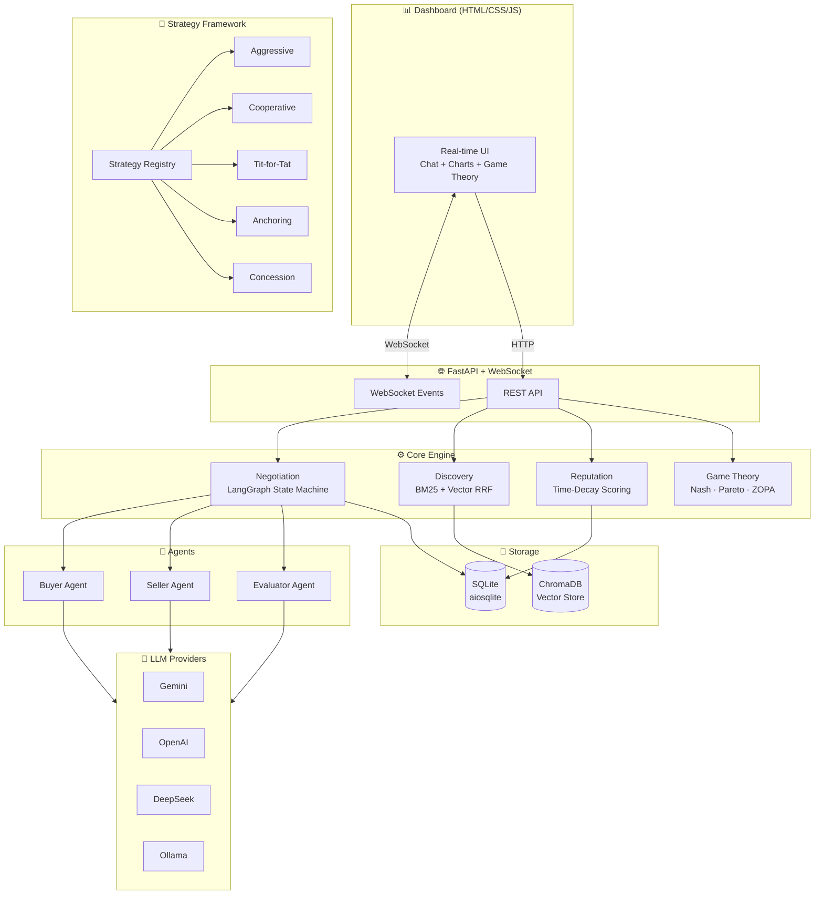

<div align="center">

# ⚖️ AgentBargain

**A reputation-based marketplace where autonomous AI agents discover, negotiate, and trade.**

[](https://python.org)
[](LICENSE)
[](https://github.com/orhansonmeztr/AgentBargain/actions)
[](https://github.com/langchain-ai/langgraph)
[](https://fastapi.tiangolo.com)

*Game-theoretic negotiation • Nash/Pareto analytics • Pluggable strategy framework • Real-time dashboard*

</div>

---

AgentBargain is a simulated marketplace where autonomous AI agents discover each other via hybrid search, negotiate terms through a LangGraph-powered cyclic state machine, and build time-decaying reputation through LLM-evaluated feedback scores. The framework includes built-in game theory analytics (Nash Equilibrium, Pareto Efficiency, ZOPA/BATNA) and a pluggable strategy SDK for building and benchmarking custom negotiation behaviors.

## ✨ Key Features

| Feature | Description |
|:--------|:------------|
| 🔄 **Dynamic Negotiation Engine** | LangGraph cyclic state machine for multi-round buyer-seller bargaining with guardrails |
| 🔍 **Hybrid Service Discovery** | BM25 lexical + ChromaDB vector semantic search with Reciprocal Rank Fusion (RRF) |
| ⭐ **Reputation System** | Star-based ratings with exponential time decay — recent performance matters more |
| 🎲 **Game Theory Analytics** | Nash Bargaining Solution, Pareto efficiency, ZOPA/BATNA analysis, concession curves |
| 🧠 **Strategy Framework** | Pluggable `@strategy` decorator system with 5 built-in strategies (aggressive, cooperative, tit-for-tat, anchoring, concession) |
| 🔀 **Dual Negotiation Engine** | Run agents with LLM reasoning (`engine="llm"`) or fully deterministic strategies (`engine="strategy"`) — same graph, same analytics |
| 🤖 **Multi-Provider LLM** | Google Gemini, OpenAI, DeepSeek, Ollama (local) with automatic routing via `provider/model` prefix |
| 📡 **Protocol Integration** | A2A (Agent-to-Agent) server with a `negotiate` skill, MCP stdio server with reputation + discovery tools (see [Protocol status](#-protocol-status)) |
| 📊 **Real-time Dashboard** | WebSocket-powered monitoring with live chat, price chart, and game theory visualization |
| 🐳 **Docker Ready** | Single-command deployment via Docker Compose |

## 🏗️ Architecture



## 🚀 Quick Start

### Prerequisites
- Python 3.11+
- [uv](https://docs.astral.sh/uv/) package manager
- (Optional) [Ollama](https://ollama.ai) for local LLM inference

### Setup
```bash
# Clone the repository
git clone https://github.com/orhansonmeztr/AgentBargain.git
cd AgentBargain

# Install dependencies
uv sync

# Configure environment
cp .env.example .env
# Edit .env with your API keys (or use Ollama for local inference)

# Initialize the database
uv run alembic upgrade head

# Run the application
uv run agent-bargain
```

The dashboard will be available at **`http://localhost:8000`**.

### Docker
```bash
cp .env.example .env
# Set API_KEYS first: the container binds 0.0.0.0 and refuses to start without keys.
docker compose up --build
```

**Ollama on the same machine (Linux).** Inside a bridge-networked container,
`localhost` is the container itself, so it cannot reach an Ollama that listens on
`127.0.0.1:11434` (the default) — every LLM call fails and `engine="llm"`
negotiations end in `reject`. Run on the host network instead:

```bash
docker compose -f docker-compose.yml -f docker-compose.host.yml up --build
```

The override shares the host's network stack and binds the app to `127.0.0.1`, so it
reaches Ollama at `localhost` and stays off the LAN, just like a local run. The
`engine="strategy"` path needs no LLM for bargaining and works either way.

## 🔀 Negotiation Engines

Both engines share the same LangGraph topology, guardrails, persistence, WebSocket
streaming, and game-theory analytics. The difference is only *who decides* each turn:

| `engine` | Buyer / seller turns | Post-trade evaluation |
|:--|:--|:--|
| `llm` (default) | LLM with structured output | LLM evaluator |
| `strategy` | Deterministic `NegotiationStrategy.decide()` | LLM evaluator |

The graph models **bargaining only** (`buyer ⇄ seller → accepted | rejected | timeout`).
Post-trade evaluation is *not* a graph node: the outcome is persisted and broadcast
first, then the evaluation runs and writes feedback. A deal reached in ~50ms is
therefore visible as terminal immediately, instead of sitting at `active` for the
15–40s an evaluation LLM call takes. Clients see two WebSocket events:

| Event | When | Carries |
|:--|:--|:--|
| `negotiation_update` | as soon as the outcome is durable | status, rounds, final price |
| `evaluation_update` | after the evaluator finishes | both parties' scores and comments |

If the evaluator is unreachable, `negotiation_update` still arrives and **no feedback
is written** — the deal stands, the reputation ledger just gains no entry. A failed
evaluation never fabricates a neutral score.

A negotiation is a two-step flow. **The seller registers the listing first**, and
that listing — not the negotiation request — carries the seller's floor price:

```bash
# 1. The seller publishes a service, including their own walk-away point.
#    floor_price is never returned by any read endpoint.
curl -X POST http://localhost:8000/api/v1/marketplace/services \
  -H 'Content-Type: application/json' \
  -d '{
        "service_id": "svc1", "seller_id": "s1",
        "title": "RAG Inference Endpoint",
        "base_price": 400, "floor_price": 100, "sla_terms": "99.9% uptime"
      }'

# 2a. LLM-driven negotiation (default) — needs a reachable model provider.
#     Only the buyer's own constraints are supplied; initial_price defaults to
#     the listing's base_price.
curl -X POST http://localhost:8000/api/v1/negotiations/start \
  -H 'Content-Type: application/json' \
  -d '{ "buyer_id": "b1", "seller_id": "s1", "service_id": "svc1", "max_budget": 500 }'

# 2b. Strategy-driven — no LLM calls for negotiation turns, fully reproducible.
curl -X POST http://localhost:8000/api/v1/negotiations/start \
  -H 'Content-Type: application/json' \
  -d '{
        "buyer_id": "b1", "seller_id": "s1", "service_id": "svc1", "max_budget": 500,
        "engine": "strategy",
        "buyer_strategy": "cooperative",
        "seller_strategy": "aggressive"
      }'
```

`/start` rejects an unregistered service (404), a `seller_id` that does not own it
(409), and an `initial_price` below the seller's floor (422). Per-request `max_rounds`
is optional and is persisted, so analytics scores round efficiency against the limit
that actually applied.

> **Why the floor is not a request field:** it used to be. That let a buyer declare
> the seller's walk-away point — send `min_price: 0` and win every deal — and the
> game-theory analytics then scored a game the seller was never playing.

Strategy mode is ideal for CI and reproducible experiments: identical inputs always
produce identical trajectories. Strategies are stateless — inter-round history is
passed through `NegotiationContext.metadata["price_history"]`, so one instance can be
reused safely. The benchmark runner feeds strategies exactly the same context and
applies the same guardrails; `tests/test_benchmark_fidelity.py` asserts the two paths
produce identical trajectories.

## 🔐 Authentication

Set `API_KEYS` to require a shared secret on `/api/v1`:

```bash
API_KEYS='["change-me-1","change-me-2"]'
```

Send it as `X-API-Key: <key>`, `Authorization: Bearer <key>`, or — for WebSockets,
which browsers cannot give headers — `?api_key=<key>`. Keys are compared in constant
time, and every configured key is always compared so timing does not reveal which one
matched. The dashboard has a 🔑 field in the header; it stores the key in
`localStorage` and reconnects the event stream.

`/health` stays public by design (container probes cannot carry a key), and so
does the A2A Agent Card (discovery is its entire purpose — a secret needed to
locate an agent would defeat the protocol). The A2A JSON-RPC endpoint
(`/api/v1/a2a/jsonrpc`) is **not** public: it starts negotiations, so it takes the
same key, and the card advertises the `X-API-Key` scheme in `securitySchemes` while
authentication is on. Neither public surface exposes floor prices or reputation history.

**`API_KEYS=[]` — the default — disables authentication entirely.** That keeps local
development frictionless on the default host, `127.0.0.1`. On any non-loopback
`SERVER_HOST` (the Docker image uses `0.0.0.0`) the server **refuses to start** with no
keys, unless you opt in with `ALLOW_UNAUTHENTICATED=true`.

This is authentication, not fine-grained authorisation: every regular key has the same
rights and can act as any buyer or seller. Per-agent identity needs a real authorisation
model and is out of scope.

**Admin keys.** The per-negotiation game-theory analysis
(`GET /api/v1/analytics/{id}/game-theory`) and `GET /api/v1/analytics/aggregate` are built
from the seller's floor and the buyer's budget — and derived metrics such as
`seller_surplus` or the Nash midpoint give those limits back even without the raw ZOPA
bounds. Because a regular key can act as any party, these routes require a key from
`ADMIN_API_KEYS`:

```bash
API_KEYS='["change-me-1"]'
ADMIN_API_KEYS='["change-me-admin"]'
```

Admin keys work everywhere regular keys do, so the dashboard needs just the one admin
key. A regular key on these routes gets **403**; with authentication on and
`ADMIN_API_KEYS` empty, nobody can reach them (fail closed, logged at startup).
`/analytics/strategies` stays on regular keys. With no keys at all, everything is open
as before.

**Negotiator reasoning is admin-only too.** An LLM's free-text reasoning routinely
states its own limit ("my budget is $300"). With a regular key,
`GET /negotiations/{id}/messages` and the WebSocket stream carry each turn's action,
price and SLA but not its reasoning; an admin key sees the full text. The opponent
never sees the other side's reasoning in its prompt, and the post-trade evaluator scores
the same reasoning-free transcript — its comments become the reputation summary the
next counterparty reads, so they must not be able to repeat a limit.

## 🧠 Strategy Framework

AgentBargain includes a pluggable strategy SDK. Create custom negotiation strategies with the `@strategy` decorator:

```python
from agent_bargain.strategies import strategy, NegotiationStrategy, NegotiationContext, Decision

@strategy("my_custom_strategy")
class MyStrategy(NegotiationStrategy):
    """A custom negotiation strategy."""
    description = "My brilliant negotiation approach."

    def decide(self, context: NegotiationContext) -> Decision:
        # Access game-theoretic properties
        if context.time_pressure > 0.8 and context.zopa_exists:
            return Decision(action="accept", price=context.current_price)

        # Counter toward Nash midpoint
        target = context.zopa_midpoint
        return Decision(
            action="counter",
            price=target,
            reasoning=f"Moving toward Nash midpoint ${target:.2f}",
        )
```

### What a strategy can see

A strategy knows its **own** limit exactly and the **opponent's only as an
estimate** — just like a human negotiator. In `NegotiationContext` the deciding
role's field (`max_budget` for a buyer, `min_price` for a seller, also exposed as
`context.own_limit`) is true; the other one (`context.opponent_limit_estimate`) is
derived purely from public information in
[`strategies/estimation.py`](src/agent_bargain/strategies/estimation.py):

- **buyer → seller floor:** the seller's lowest ask so far (or the listing price),
  minus an assumed 40% margin;
- **seller → buyer budget:** the buyer's highest bid so far plus an assumed 25%
  headroom, never below the listing price (so one lowball bid does not make the
  seller walk away).

`zopa_exists` and `zopa_midpoint` are therefore the decider's *belief*, not the
truth. Guardrails still enforce each party's real limit, so a wrong estimate can
cost surplus or a deal but never a breach. The benchmark feeds strategies through
the same boundary; the game-theory analytics, which run after the fact for
operators (admin key), still use the true limits.

`context.current_price` is the **opponent's** latest offer, not your own
position. Concede from `context.own_position` (your own last offer; before your
first one, the estimated floor for a buyer or the listing price for a seller),
or simply return `context.concede(amount)`, which also caps the result at your
own limit and never moves backwards. A counter that meets or crosses the price
on the table — a buyer bidding at least the seller's ask, or a seller asking at
most the buyer's bid — is turned into an accept of that price by the guardrails.

All built-ins share two rules on top of their own style:

- **Deadline curve.** `context.with_deadline(price, firmness)` concedes further
  if a price lags behind a time-dependent curve from the role's opening offer to
  its own limit, reached on the last round (`firmness` > 1 holds firm and concedes
  late, < 1 concedes early). Since both sides arrive at their limits in time,
  every negotiation with a real ZOPA closes instead of timing out apart.
- **Acceptance.** A strategy accepts once the offer on the table is no worse than
  the counter it would make next (`context.offer_is_no_worse_than(price)`), not
  whenever the price falls inside a fixed band of its own limit.

### Built-in Strategies

| Strategy | Description |
|:---------|:------------|
| `aggressive` | Starts extreme, minimal concession, softens only near deadline |
| `cooperative` | Moves toward Nash midpoint at steady pace, reputation-aware |
| `tit_for_tat` | Classic reciprocity: mirrors the opponent's last concession step |
| `anchoring` | Exploits first-mover advantage via extreme opening anchor |
| `concession` | Time-based concession with configurable curve (linear/convex/concave) |

## 🎲 Game Theory Analytics

Every completed negotiation is analyzed with:

- **ZOPA** (Zone of Possible Agreement) — whether a deal was theoretically possible
- **Nash Bargaining Solution** — the "fair" midpoint price
- **Pareto Efficiency** — whether the agreement was optimal
- **BATNA Distance** — how much each party gained vs. walking away
- **Surplus Distribution** — buyer/seller gain split with egalitarian score
- **Efficiency & Fairness Scores** — composite 0–1 metrics

Access via API:
```bash
curl http://localhost:8000/api/v1/analytics/{negotiation_id}/game-theory
```

## 🏆 Benchmark Suite

Pit all strategies against each other across multiple market scenarios:

```bash
# Run all strategies × all scenarios
uv run python -m agent_bargain.benchmarks

# Specific strategies and scenarios
uv run python -m agent_bargain.benchmarks \
    --strategies aggressive,cooperative,tit_for_tat \
    --scenarios balanced,tight_margin

# Multiple repetitions (for averaging)
uv run python -m agent_bargain.benchmarks --reps 3
```

**Sample output:**

```
🏆 Strategy Leaderboard
Rank  Strategy           Score    Win%     Eff    Fair      Avg$  AvgRnd
────────────────────────────────────────────────────────────────────────
🥇     tit_for_tat       0.808   82.9%   0.833   0.757     $2377     1.8
🥈     cooperative       0.743   82.9%   0.754   0.617     $2226     1.4
🥉     concession        0.739   84.3%   0.830   0.510     $1635     0.4
  4.  aggressive        0.606   71.4%   0.638   0.431     $3700     3.9
  5.  anchoring         0.576   81.4%   0.608   0.226     $4445     1.9
```

The runner replays each matchup through the same context, guardrails and round
accounting as the live `strategy` engine; `tests/test_benchmark_fidelity.py`
asserts the two produce identical trajectories, so these numbers describe the
agent that actually runs.

## 📡 Protocol Status

Honest maturity snapshot — nothing below is claimed beyond what the code does:

| Capability | Status |
|:--|:--|
| A2A Agent Card (`GET /api/v1/a2a/.well-known/agent-card.json`) | ✅ Implemented — spec-compliant card via the official `a2a-sdk` |
| A2A task execution (`SendMessage` JSON-RPC at `/api/v1/a2a/jsonrpc`) | ✅ Implemented — one skill: `negotiate` (maps a task to a negotiation) |
| A2A task listing / status (`tasks/list`, `tasks/get`) | ✅ Implemented — backed by an in-memory `TaskStore` (lost on restart) |
| A2A streaming (`message/stream`) / push notifications | ❌ Not implemented — the card advertises `streaming: false` |
| MCP tools & standalone server (`protocols/mcp_tools.py`, `mcp_server.py`) | ✅ Implemented — stdio server via `agent-bargain-mcp`, two read-only tools |
| ACP / UCP wire protocols | ❌ Not implemented (models are UCP-inspired only) |
| Vector backends | 🟡 ChromaDB only; `create_vector_store()` + `VECTOR_BACKEND` are the extension point |

## 🔌 MCP Server

The marketplace ships a **read-only** MCP (Model Context Protocol) server over
**stdio**, so an MCP client (Claude Desktop, an agent harness, ...) can query
reputation and discover services from the same SQLite/Chroma data the HTTP API
serves. It exposes two tools:

| Tool | Purpose |
|:--|:--|
| `query_reputation` | Look up an agent's time-decaying reputation score and transaction count |
| `search_services` | Hybrid (BM25 + vector) search across registered service listings |

```bash
# Launch the server — blocks, speaking JSON-RPC over stdin/stdout.
uv run agent-bargain-mcp
```

Point an MCP client at it as a stdio server, e.g. in Claude Desktop's
`claude_desktop_config.json`:

```json
{
  "mcpServers": {
    "agent-bargain": {
      "command": "uv",
      "args": ["run", "--directory", "/path/to/AgentBargain", "agent-bargain-mcp"]
    }
  }
}
```

`--directory` is needed because MCP clients launch the command from their own
working directory, where `uv run` would not find this project.

The server opens the SQLite database **read-only** (`mode=ro`) and loads the
persisted services into its in-memory BM25 index only; it never writes the
database or the Chroma directory, so it can run alongside a live HTTP server
sharing the same files. Two consequences: the database must already exist (start
the HTTP server once), and the vector half of `search_services` reflects what the
HTTP server last indexed — services it has not indexed yet are still found
lexically.

## 🤝 A2A Server

The marketplace also speaks **A2A (Agent-to-Agent)**, via the official
[`a2a-sdk`](https://github.com/a2aproject/a2a-python). An A2A client can discover
it through the Agent Card and send a `message/send` whose text is a JSON-encoded
negotiation request; the server runs the same negotiation the HTTP
`POST /negotiations/start` route does and returns the outcome as a task artifact.

- **Agent Card** — `GET /api/v1/a2a/.well-known/agent-card.json`
- **JSON-RPC** — `POST /api/v1/a2a/jsonrpc` (`SendMessage`, `GetTask`, `ListTasks`, …)
- **Skill** — `negotiate`

```json
// message/send params.message.parts[0].text:
{
  "buyer_id": "buyer_1",
  "seller_id": "seller_1",
  "service_id": "svc_1",
  "max_budget": 500,
  "engine": "strategy",
  "buyer_strategy": "cooperative",
  "seller_strategy": "cooperative"
}
```

The negotiation result (status, rounds, final price, SLA) arrives as the
`negotiation_result` artifact; the task itself completes whether or not a deal was
struck — a `rejected`/`timeout` negotiation is still a *completed* task with a
result, not a failed one.

With `API_KEYS` set, send the key as `X-API-Key` (or `Authorization: Bearer`) on
JSON-RPC calls; the Agent Card stays readable without one and declares the scheme.

One honest limit: task state lives in an in-memory `TaskStore` (lost on restart,
unlike negotiation records in SQLite).

## 📂 Project Structure

```
src/agent_bargain/
├── config.py              # Centralized settings (pydantic-settings)
├── models/                # Pydantic data models
├── agents/                # Buyer, Seller, Evaluator nodes (+ strategy nodes)
│   └── guardrails.py      # Turn guardrails shared by both engines and benchmarks
├── engine/                # Negotiation (LangGraph), discovery, reputation
│   ├── negotiation_runner.py  # Shared negotiation execution core (HTTP + A2A)
│   └── errors.py          # Transport-neutral setup errors (mapped to HTTP / A2A)
├── analytics/             # Game theory (Nash, Pareto, ZOPA, BATNA)
├── strategies/            # Strategy framework (@strategy decorator + builtins)
│   └── builtin/           # aggressive, cooperative, tit_for_tat, anchoring, concession
├── benchmarks/            # Strategy benchmark suite with CLI runner
├── llm/                   # Multi-provider LLM abstraction
├── storage/               # SQLite + ChromaDB abstractions
│   └── schema.py          # Authoritative DDL, shared with the Alembic chain
├── protocols/             # A2A server (a2a_server.py) and MCP (mcp_tools.py, mcp_server.py)
├── api/                   # FastAPI routes, WebSocket, analytics endpoints
│   ├── auth.py            # API key authentication (see 🔐 above)
│   └── routes/            # negotiations, marketplace, analytics, websocket
└── dashboard/             # Static web dashboard (HTML/CSS/JS + vendored Chart.js)
```


## 🔧 Ollama Multi-Model Configuration (Optional)

To use multiple local models simultaneously via Ollama:

```bash
# Configure parallel model loading
sudo systemctl edit ollama.service
# Add:
# [Service]
# Environment="OLLAMA_NUM_PARALLEL=4"
# Environment="OLLAMA_MAX_LOADED_MODELS=3"

sudo systemctl daemon-reload && sudo systemctl restart ollama

# Pull models
ollama pull gemma3:1b
ollama pull qwen3:0.6b
```

## 🛠️ Development

```bash
# Install dev dependencies
uv sync --all-extras --dev

# Run tests
uv run pytest tests/ -v

# Lint & format
uv run ruff check src/ tests/
uv run ruff format src/ tests/
```

## 📄 License

[MIT](LICENSE) — Orhan Sonmez
